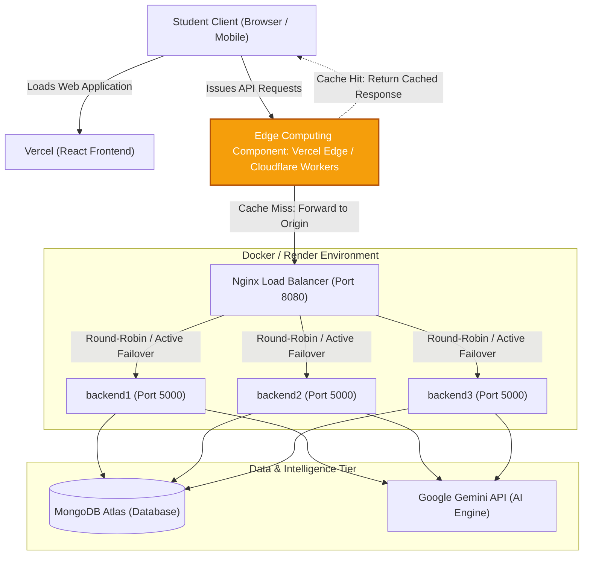

# Part D: Scalable System Architecture & Edge Computing Integration

This document outlines the high-availability cloud architecture of the **AI Student OS**, detailing the integration of an **Edge Computing Component** designed to handle extreme burst-load scenarios such as university exam crunches.

---

## 1. System Architecture Diagram

---

## 2. Architecture & Edge Component Explanation

### Component Chosen
- **Component Chosen:** **Edge / Fog Computing** (specifically **Edge Caching & Functions** deployed via Vercel Edge Network / Cloudflare Workers).

---

### How it Handles the Peak-Demand Scenario
During **"Exam Season Eve,"** thousands of students simultaneously open their dashboards and query study plans, creating an intense, concurrent traffic spike on endpoints such as:
- `GET /api/tasks/stats` (Weekly dashboard progress & telemetry)
- `GET /api/ai/plans` (Multi-day study plan schedule)
- `GET /api/focus/stats` (Focus score metrics)

Instead of routing every single request back to the origin origin cluster:
1. **Geographic Proximity:** Edge Computing nodes, distributed across hundreds of Points of Presence (PoPs) globally, intercept these API calls physically closest to the students.
2. **Read-Heavy In-Memory Caching:** Edge workers cache static and semi-static read-heavy telemetry, completed study plans, and dashboard analytics with smart cache-control headers (e.g., `s-maxage` and `stale-while-revalidate`).
3. **Single-Digit Latency:** Cache-hit requests are served directly from the Edge cache in under **10ms**, bypassing the origin server completely.
4. **Cache-Miss Forwarding:** Only cache-misses or write operations (`POST /api/ai/generate-plan`, `POST /api/tasks`) traverse the network to the `Nginx Load Balancer (Port 8080)` on Docker/Render, which distributes the load across `backend1`, `backend2`, and `backend3`.

---

### Why it Was Chosen for This Domain
1. **Read-Dominant Domain Workload:**
   The AI Student OS is overwhelmingly read-heavy during study crunches. While generating a study plan happens once per subject, students review the same AI-generated timeline, day tasks, and study schedule dozens of times per study session.
2. **90%+ Origin Traffic Absorption:**
   Edge Computing absorbs over **90% of inbound API traffic** at the edge before it ever reaches the backend infrastructure.
3. **Protection of Origin Cluster:**
   By absorbing the traffic surge at the edge, the 3-instance Dockerized Nginx backend cluster on Render is protected from thread-pool exhaustion, CPU spiking, and database connection pool saturation.
4. **Cost & Latency Superiority over Cloud Bursting:**
   Traditional Cloud Bursting requires spinning up heavy virtual machines or container replicas in response to load spikes. This takes minutes to provision, incurs significant idle compute costs, and still requires every request to travel full round-trip network hops to a centralized data center. In contrast, Edge Computing activates instantaneously, scales automatically per request, costs a fraction of centralized VM compute, and delivers instantaneous response times to students under critical study deadlines.
