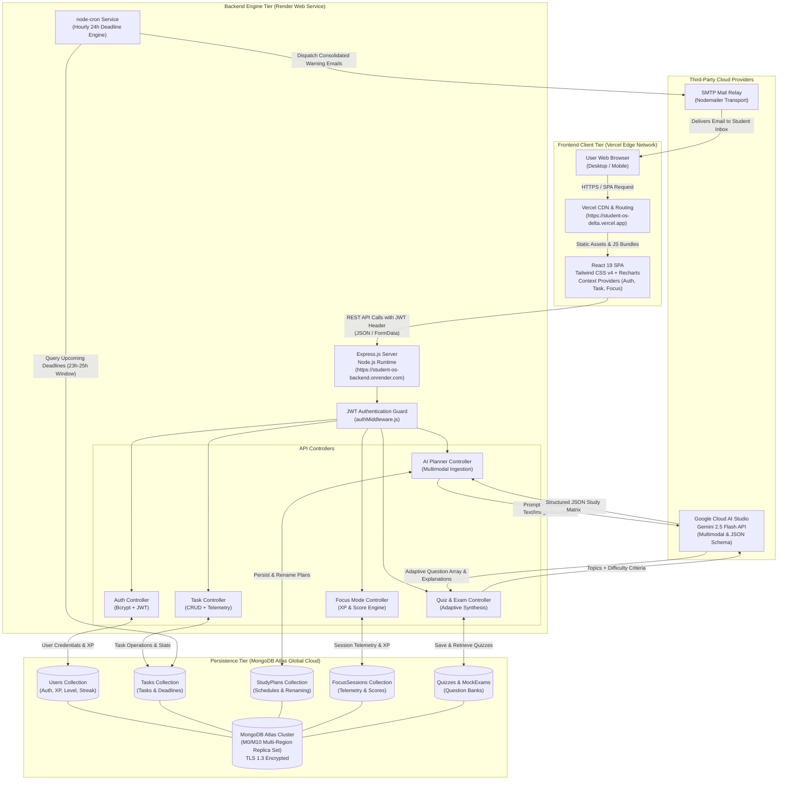

# AI Student OS — Comprehensive System Documentation & Architecture Specification

> **AI Student OS** is an intelligent, gamified academic operating system built on the MERN stack. It streamlines student workflows through automated multimodal study plan generation, adaptive daily quizzes, timed mock exams, distraction-free deep focus sessions, and automated deadline reminders.

---

## 1. Project Links & Deployment Metadata

| Resource | URL / Details | Description |
| :--- | :--- | :--- |
| **Source Code Repository** | [https://github.com/Turbo-Light/Student_OS](https://github.com/Turbo-Light/Student_OS) | Official GitHub repository hosting full-stack monorepo (`frontend/` and `backend/`). |
| **Deployed Application URL** | [https://student-os-delta.vercel.app](https://student-os-delta.vercel.app) | Production web application running on Vercel Edge Network. |
| **Backend API Service** | `https://student-os-backend.onrender.com` | Production REST API service deployed on Render Web Services. |
| **Health Check Endpoint** | `https://student-os-backend.onrender.com/api/health` | Live diagnostic route returning operational status, database state, and server uptime. |

---

## 2. Cloud Services & Architectural Components

AI Student OS is engineered as a decoupled, multi-tier modern web application leveraging cloud-native infrastructure, Google Cloud's multimodal generative AI models, and real-time database clustering.

```
┌────────────────────────────────────────────────────────────────────────┐
│                        AI STUDENT OS ARCHITECTURE                      │
├────────────────────────────────────────────────────────────────────────┤
│  Frontend (Vercel)          Backend (Render)         Data & Cloud      │
│  ┌──────────────────┐       ┌─────────────────┐      ┌───────────────┐ │
│  │ React 19 SPA     │◄─────►│ Express 4.19 API│◄────►│ MongoDB Atlas │ │
│  │ Tailwind CSS v4  │ (JWT) │ Node.js v20+    │      │ Cloud Cluster │ │
│  │ Vite 8 Build     │       │ node-cron Engine│      └───────────────┘ │
│  └──────────────────┘       └────────┬────────┘              ▲         │
│                                      │                       │         │
│                                      ▼                       ▼         │
│                             ┌─────────────────┐      ┌───────────────┐ │
│                             │ Google Gemini   │      │ SMTP Relay    │ │
│                             │ 2.5 Flash API   │      │ (Nodemailer)  │ │
│                             └─────────────────┘      └───────────────┘ │
└────────────────────────────────────────────────────────────────────────┘
```

### 2.1 Technology Stack & Architectural Roles

| Component | Technology | Cloud Provider | Architectural Role |
| :--- | :--- | :--- | :--- |
| **Frontend Client** | **React 19**, **Vite 8**, **Tailwind CSS v4**, React Router v7, Recharts, Lucide React, React Hot Toast | **Vercel** | Responsive, low-latency Single Page Application (SPA) with sleek dark-mode SaaS aesthetics, interactive analytics charts, and keyboard shortcuts. |
| **Backend Engine** | **Node.js (v20+)**, **Express.js (v4.19)**, ES Modules | **Render** | High-throughput REST API with JWT bearer token authentication, robust input validation, and centralized error handling. |
| **Database & ORM** | **MongoDB Atlas**, **Mongoose (v8.3)**, `mongodb-memory-server` | **MongoDB Cloud (Atlas)** | Schema-enforced document storage with automated indexing, relationships, and transparent in-memory fallback for local offline development. |
| **Generative AI** | **Google Gemini API (`gemini-2.5-flash`)**, `@google/generative-ai` SDK | **Google Cloud AI Studio** | Multimodal syllabus document processing, structured JSON study generation, adaptive question synthesis, and exam compilation. |
| **Background Automation** | **`node-cron`**, **`nodemailer`** | **Render Worker** | Hourly scheduled task scanning for 24-hour deadline proximity and dispatching consolidated email alerts. |

---

### 2.2 Google Gemini AI Engine Integration

The platform integrates Google's `gemini-2.5-flash` model with enforced JSON response schemas (`generationConfig: { responseMimeType: "application/json" }`) across three core educational subsystems:

#### A. Multimodal AI Study Planner (`/api/ai`)
- **Text-Based Syllabus Ingestion (`POST /api/ai/generate/text`)**: Parses dense academic syllabi, target exam dates, and daily study hour allocations. Prompts Gemini to break subjects into granular daily blocks (topics, durations, practice problems, and revision tasks) capped precisely at target days, accompanied by an AI-chosen 2–4 word title.
- **Image-Based Syllabus Ingestion (`POST /api/ai/generate/image`)**: Ingests syllabus screenshots or textbook outlines via `multer` in-memory buffers (`multipart/form-data`). Passes base64 image data directly to Gemini's vision pipeline for automated text extraction, topic hierarchy synthesis, and multi-day study schedule generation.
- **Dynamic Plan Management**: Allows saving multiple generated study plans, viewing them in a dedicated library, and performing inline title renaming (`PUT /api/ai/plans/:id/rename`) with instant UI reactivity.

#### B. Daily Quiz Generation Engine (`POST /api/quizzes/generate`)
- Generates 8 adaptive daily practice questions directly tied to the student's active study day topics.
- Dynamically selects optimal question types based on subject nature:
  - **MCQ (Multiple Choice)**: 4 distinct choices (`A`, `B`, `C`, `D`) with unambiguous answer keys.
  - **ShortAnswer**: Conceptual review questions.
  - **Coding**: Algorithmic and programmatic problems (invoked for CS, Mathematics, and logic courses).
- Enforces strict pedagogical explanations for all questions for post-submission review.

#### C. Comprehensive Mock Exam System (`POST /api/mock-exams/generate`)
- Synthesizes full-length practice examinations partitioned into structured sections:
  - **Part A (Objective Foundation)**: Multiple-choice questions evaluating core principles.
  - **Part B (Subjective & Practical Application)**: Deep problem-solving and coding questions.
- Configurable question counts (3–20 questions), timed execution environments (15–180 minutes), and automated evaluation.

---

### 2.3 Automated Background Task & Email Engine

- Built with **`node-cron`** running inside the Node.js backend.
- Runs an automated scan every hour searching for active tasks where:
  $$\text{now} + 23\,\text{hours} \le \text{task.deadline} \le \text{now} + 25\,\text{hours}$$
- Groups upcoming deadlines by student and dispatches a consolidated reminder email via **`nodemailer`** to prevent inbox spam.

---

## 3. Database Design

Data persistence is managed through MongoDB using strictly typed Mongoose models. Below is the technical specification of the schema design:

### 3.1 Collections & Schema Specifications

#### 1. Users Collection (`models/User.js`)
Stores student authentication credentials, profile roles, and gamification progress.
```javascript
{
  name:      { type: String, required: true, trim: true },
  email:     { type: String, required: true, unique: true, lowercase: true, trim: true },
  password:  { type: String, required: true, minlength: 6 }, // Hashed with bcrypt (salt: 10)
  role:      { type: String, enum: ['student', 'admin'], default: 'student' },
  xp:        { type: Number, default: 0 },                    // Gamification total experience points
  level:     { type: Number, default: 1 },                    // User tier level
  streak:    { type: Number, default: 0 },                    // Consecutive active study days
  createdAt: { type: Date, default: Date.now },
  updatedAt: { type: Date, default: Date.now }
}
```
- **Hooks**: `pre('save')` automatically hashes password modifications with `bcryptjs`.
- **Methods**: `matchPassword(enteredPassword)` executes asynchronous bcrypt comparison.

#### 2. Tasks Collection (`models/Task.js`)
Tracks personal and AI-generated assignments, milestones, and deliverables.
```javascript
{
  user:          { type: ObjectId, ref: 'User', required: true, index: true },
  title:         { type: String, required: true, trim: true },
  description:   { type: String, trim: true },
  status:        { type: String, enum: ['Pending', 'In-Progress', 'Completed'], default: 'Pending' },
  priority:      { type: String, enum: ['Low', 'Medium', 'High'], default: 'Medium' },
  dueDate:       { type: Date },
  deadline:      { type: Date },
  subject:       { type: String, trim: true },
  isAiGenerated: { type: Boolean, default: false },
  source:        { type: String, default: 'user' }, // 'user' | 'ai'
  createdAt:     { type: Date, default: Date.now },
  updatedAt:     { type: Date, default: Date.now }
}
```

#### 3. Study Plans Collection (`models/StudyPlan.js`)
Stores personalized multi-day curriculum matrices generated by Gemini AI.
```javascript
{
  user:       { type: ObjectId, ref: 'User', required: true, index: true },
  subject:    { type: String, required: true }, // Display title (supports inline renaming)
  examDate:   { type: Date },
  dailyHours: { type: Number, default: 2 },
  plan:       { type: Array, required: true },  // Array of daily objects: { day, topics, studyTime, revisionTasks, practiceTasks }
  createdAt:  { type: Date, default: Date.now },
  updatedAt:  { type: Date, default: Date.now }
}
```

#### 4. Focus Sessions Collection (`models/FocusSession.js`)
Logs deep-work interval telemetry, pause frequencies, session notes, and calculated focus scores.
```javascript
{
  user:              { type: ObjectId, ref: 'User', required: true, index: true },
  subject:           { type: String },
  topic:             { type: String },
  task:              { type: ObjectId, ref: 'Task' },
  plannedDuration:   { type: Number, required: true }, // In minutes
  actualFocusedTime: { type: Number, default: 0 },      // In seconds
  pausedTime:        { type: Number, default: 0 },      // In seconds
  pausesCount:       { type: Number, default: 0 },
  goal:              { type: String },
  goalAchievement:   { type: String, enum: ['achieved', 'partially', 'not_achieved', 'pending'], default: 'pending' },
  quickNotes:        { type: [String], default: [] },
  focusScore:        { type: Number, default: 0 },      // 0 to 100
  xpEarned:          { type: Number, default: 0 },
  completed:         { type: Boolean, default: false },
  createdAt:         { type: Date, default: Date.now },
  updatedAt:         { type: Date, default: Date.now }
}
```

#### 5. Quizzes Collection (`models/Quiz.js`)
Persists adaptive practice tests and question breakdowns.
```javascript
{
  userId:    { type: ObjectId, ref: 'User', required: true, index: true },
  subject:   { type: String, required: true },
  dayNumber: { type: Number, required: true },
  topics:    { type: [String], required: true },
  questions: [{
    type:          { type: String, enum: ['MCQ', 'ShortAnswer', 'Coding'], required: true },
    question:      { type: String, required: true },
    options:       { type: [String] },
    correctAnswer: { type: String, required: true },
    explanation:   { type: String, required: true }
  }],
  score:     { type: Number, default: null },
  createdAt: { type: Date, default: Date.now }
}
```

#### 6. Mock Exams Collection (`models/MockExam.js`)
Stores structured multi-part examinations and student grading outcomes.
```javascript
{
  userId:          { type: ObjectId, ref: 'User', required: true, index: true },
  subject:         { type: String, required: true },
  syllabus:        { type: String, required: true },
  durationMinutes: { type: Number, default: 120 },
  sections:        [{
    sectionName:  { type: String, required: true },
    instructions: { type: String, required: true },
    questions:    [ /* questionSchema */ ]
  }],
  score:           { type: Number, default: null },
  isCompleted:     { type: Boolean, default: false },
  createdAt:       { type: Date, default: Date.now }
}
```

---

### 3.2 Gamification & XP Progression Engine

The application rewards students with experience points (XP) to incentivize sustained study habits:

1. **Task Completion**: Marking any task as `Completed` awards **+50 XP**.
2. **Deep Work Focus Sessions**:
   - Base XP: **10 XP per 5 minutes** of verified focused time.
   - Goal Achievement Multipliers:
     - `Achieved`: **+50 Bonus XP** + 100% Focus Score weighting.
     - `Partially`: **+25 Bonus XP** + 75% Focus Score weighting.
     - `Not Achieved`: **+0 Bonus XP** + 50% Focus Score weighting.
   - Pause Deductions: Each pause deducts 5 points from the Focus Score calculation.
3. **Level Calculation Formula**:
   $$\text{Level} = \left\lfloor \frac{\text{Total XP}}{500} \right\rfloor + 1$$
   Users automatically level up upon reaching every 500 XP threshold.

---

## 4. API Documentation

All protected endpoints require an `Authorization: Bearer <JWT_TOKEN>` HTTP header.

### 4.1 Authentication Service (`/api/auth`)

| Method | Endpoint | Access | Description | Request Payload | Response |
| :--- | :--- | :--- | :--- | :--- | :--- |
| `POST` | `/api/auth/register` | Public | Registers a new student account, hashes password, returns JWT. | `{ name, email, password }` | `{ _id, name, email, role, token, xp, level }` |
| `POST` | `/api/auth/login` | Public | Authenticates credentials and issues a signed JWT (30-day expiry). | `{ email, password }` | `{ _id, name, email, role, token, xp, level }` |
| `GET` | `/api/auth/profile` | Private | Returns currently authenticated user document and statistics. | None | `{ _id, name, email, xp, level, streak }` |

---

### 4.2 Task Management Service (`/api/tasks`)

| Method | Endpoint | Access | Description | Request Payload | Response |
| :--- | :--- | :--- | :--- | :--- | :--- |
| `GET` | `/api/tasks` | Private | Retrieves all tasks belonging to the authenticated user. | None | `[ { _id, title, status, priority, ... } ]` |
| `POST` | `/api/tasks` | Private | Creates a new task card (user-authored or AI-generated). | `{ title, description, priority, status, dueDate, deadline, subject, isAiGenerated, source }` | `{ _id, title, status, priority, ... }` |
| `GET` | `/api/tasks/stats` | Private | Aggregated metrics: total, completed, pending, in-progress, high-priority counts. | None | `{ total, completed, pending, inProgress, highPriority }` |
| `PUT` | `/api/tasks/:id` | Private | Updates an existing task by ID (awards XP on transition to Completed). | `{ status, priority, title, description, ... }` | Updated Task Document |
| `DELETE` | `/api/tasks/:id` | Private | Permanently removes a task by ID. | None | `{ message: "Task removed" }` |

---

### 4.3 Multimodal Gemini AI Service (`/api/ai`)

| Method | Endpoint | Access | Description | Request Payload | Response |
| :--- | :--- | :--- | :--- | :--- | :--- |
| `POST` | `/api/ai/generate/text` | Private | Generates a structured multi-day study plan from raw syllabus text using Gemini. | `{ syllabusText, examDate, hoursPerDay, days }` | `{ studyPlan, plan, title, planDoc }` |
| `POST` | `/api/ai/generate/image`| Private | Uploads a syllabus image (`multipart/form-data`) and runs multimodal schedule extraction. | `FormData { image: File, examDate, hoursPerDay, days }` | `{ studyPlan, plan, title, planDoc }` |
| `GET` | `/api/ai/plans` | Private | Retrieves all saved study plans in the student's personal library. | None | `[ { _id, subject, examDate, dailyHours, plan, createdAt } ]` |
| `PUT` | `/api/ai/plans/:id/rename` | Private | Renames a saved study plan title in-place without page refresh. | `{ title: "New Subject Title" }` | Updated StudyPlan Document |
| `GET` | `/api/ai/plan` | Private | Returns the most recent study plan (backward compatibility route). | None | `{ _id, studyPlan, subject, examDate, dailyHours }` |

---

### 4.4 Quiz & Mock Exam Services (`/api/quizzes`, `/api/mock-exams`)

| Method | Endpoint | Access | Description | Request Payload | Response |
| :--- | :--- | :--- | :--- | :--- | :--- |
| `POST` | `/api/quizzes/generate` | Private | Synthesizes an 8-question adaptive practice test for a specific study day block. | `{ subject, dayNumber, topics }` | `{ _id, subject, dayNumber, topics, questions }` |
| `GET` | `/api/quizzes/:userId` | Private | Retrieves historical quiz results and questions for a user. | None | Array of Quiz Documents |
| `POST` | `/api/mock-exams/generate`| Private | Generates a structured, multi-section mock exam (MCQ + Subjective + Coding). | `{ subject, syllabusText, durationMinutes, questionType, questionCount }` | `{ _id, subject, sections, durationMinutes }` |
| `GET` | `/api/mock-exams/:userId` | Private | Fetches past mock examination attempts and evaluation scores. | None | Array of MockExam Documents |

---

### 4.5 Focus Session Service (`/api/focus`)

| Method | Endpoint | Access | Description | Request Payload | Response |
| :--- | :--- | :--- | :--- | :--- | :--- |
| `POST` | `/api/focus/start` | Private | Initializes a new deep work session, logging start timestamps and goals. | `{ subject, topic, taskId, plannedDuration, goal }` | Newly created FocusSession Document |
| `PUT` | `/api/focus/:id/end` | Private | Finalizes session, computes focus score, applies XP gamification to user profile. | `{ actualFocusedTime, pausedTime, pausesCount, goalAchievement, quickNotes }` | `{ session, focusScore, xpEarned, user: { xp, level } }` |
| `GET` | `/api/focus/stats` | Private | Aggregates weekly historical focus scores (Mon–Sun) for Recharts analytics. | None | `{ weeklyScores: [...], totalFocusTime, avgScore }` |

---

## 5. Cloud Architecture Diagram

The diagram below illustrates the end-to-end cloud infrastructure, continuous data flows, and secure communication channels between the user's browser, Vercel Edge hosting, the Render backend container, MongoDB Atlas, and external AI services.



---

## 6. Development & Local Setup Guide

### 6.1 Prerequisites
- **Node.js**: `v20.0.0` or higher
- **npm**: `v10.0.0` or higher
- **Google Gemini API Key**: Acquired via Google AI Studio
- **MongoDB**: External MongoDB Atlas connection URI or local MongoDB instance (automatic fallback to embedded MongoDB is included if no connection is detected).

### 6.2 Installation Steps

1. **Clone the Repository**:
   ```bash
   git clone https://github.com/Turbo-Light/Student_OS.git
   cd Student_OS
   ```

2. **Backend Setup**:
   ```bash
   cd backend
   npm install
   # Create .env file with PORT, MONGO_URI, JWT_SECRET, GEMINI_API_KEY
   npm run dev
   ```

3. **Frontend Setup**:
   ```bash
   cd ../frontend
   npm install
   npm run dev
   ```

4. **Verify Application**:
   - Frontend running on: `http://localhost:5173`
   - Backend running on: `http://localhost:5000`
   - Health Check: `http://localhost:5000/api/health`
